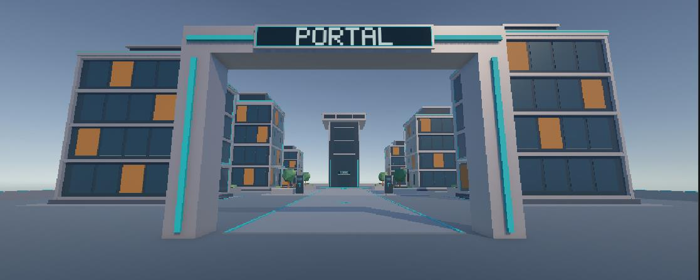
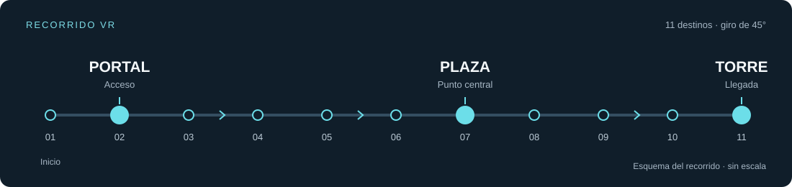
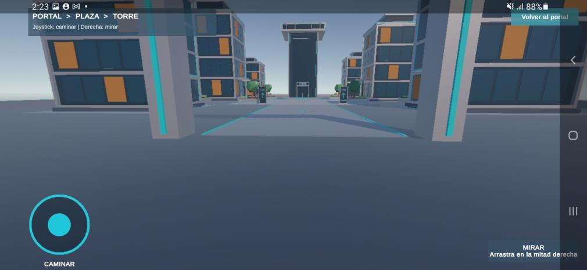
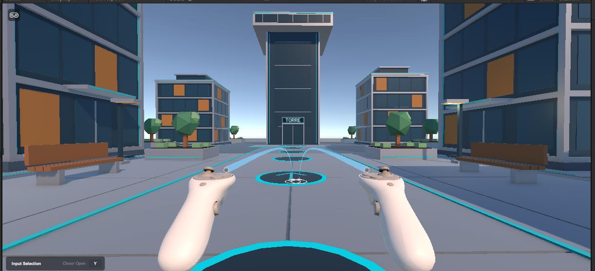

<h1 align="center">Ciudad Futurista 2050</h1>

<strong>Un recorrido urbano entre el Portal, la Plaza y la Torre.</strong> Entorno 3D en Unity · Navegación en PC y Android · Realidad virtual con OpenXR

  
  
  

  <a href="#recorrido">Recorrido</a> · <a href="#ejecucion">Ejecución</a> · <a href="#controles">Controles</a> · <a href="#vr">Configuración VR</a> · <a href="#versiones">Versiones</a> · <a href="#estructura">Estructura</a>

## 🏙️ Recorrido

La ciudad organiza seis edificios alrededor de un eje central que conecta **Portal → Plaza → Torre**. La señalización, los bordes de color cian y el mobiliario urbano orientan el desplazamiento. La navegación convencional utiliza un `CharacterController`; la escena VR incorpora **11 puntos de teletransporte** y giros de **45°**.

|                                 📱 Navegación en Android                                  |                                       🥽 Simulación VR en Unity                                       |
| :---------------------------------------------------------------------------------------: | :---------------------------------------------------------------------------------------------------: |
|  |  |

## 🚀 Ejecución

### Android · aplicación instalada

1. Descargar [**CiudadFuturista2050.apk**](Entrega/Builds/Android/CiudadFuturista2050.apk) desde la opción de descarga del archivo.
2. Transferir el APK al teléfono, abrirlo y autorizar la instalación desde esa aplicación cuando Android lo solicite.
3. Iniciar **CiudadFuturista2050** y recorrer la ciudad con los controles táctiles.

La aplicación móvil funciona en pantalla horizontal y no requiere un visor ni Unity Editor.

### Unity · proyecto editable

1. Clonar el repositorio o descargarlo con **Code → Download ZIP** y descomprimirlo.
2. En Unity Hub, agregar la carpeta que contiene `Assets`, `Packages` y `ProjectSettings`.
3. Abrir con **Unity 6000.3.29f1**, con una licencia activa en Hub, y esperar la importación.
4. Abrir la escena correspondiente y pulsar **Play** con la ventana **Game** enfocada.

| Modalidad            | Escena en `Assets/_TA5/Scenes/`                                                                                                   |
| -------------------- | --------------------------------------------------------------------------------------------------------------------------------- |
| PC / móvil           | [`CiudadFuturista2050.unity`](Assets/_TA5/Scenes/CiudadFuturista2050.unity)                                                       |
| Visor / simulador XR | [`CiudadFuturista2050_VR.unity`](Assets/_TA5/Scenes/CiudadFuturista2050_VR.unity), con la [configuración VR](#vr) correspondiente |

Los objetos y recorridos ya están guardados en las escenas.

### Windows · visor físico

Con SteamVR abierto y el visor y los mandos detectados, ejecutar `CiudadFuturista2050.exe` desde [**Entrega/Builds/Windows_VR**](Entrega/Builds/Windows_VR). La carpeta debe conservarse completa, incluidos los archivos de datos y bibliotecas.

## 🎮 Controles

| Modalidad        | Desplazamiento y mirada                                                                                                          | Acciones adicionales                                 |
| ---------------- | -------------------------------------------------------------------------------------------------------------------------------- | ---------------------------------------------------- |
| **PC**           | `WASD` o flechas para caminar; clic derecho mantenido para mirar                                                                 | `R`: volver al Portal · `Esc`: liberar cursor        |
| **Android**      | Joystick izquierdo para caminar; arrastre en la mitad derecha para mirar                                                         | Botón **Volver al portal**                           |
| **Simulador XR** | Clic derecho para alternar el control del ratón; mantener `I` para apuntar y soltar sobre un punto válido para teletransportarse | `J` / `L`: giro de 45°                               |
| **HTC VIVE**     | Mirada con el visor; apuntar a un destino con el mando y confirmar la selección                                                  | Giro por pasos mediante las acciones del controlador |

## 🥽 Configuración VR

La copia del proyecto está configurada para **simulación dentro del Editor**. Para utilizar HTC VIVE, se cambia al modo de visor antes de ejecutar o generar una compilación.

En **Edit → Project Settings → XR Plug-in Management**, pestaña **PC**, se mantiene **OpenXR** habilitado. En **OpenXR → Enabled Interaction Profiles**, el perfil es **HTC Vive Controller Profile** para los mandos VIVE originales.

| Ajuste                                                                | Visor físico                           | Simulador en Unity                                 |
| --------------------------------------------------------------------- | -------------------------------------- | -------------------------------------------------- |
| **Initialize XR on Startup**, en XR Plug-in Management → PC           | ✅ Activado                            | ⬜ Desactivado                                     |
| Objeto `09_Recorrido_VR/XR Interaction Simulator`, en la escena       | ⬜ Desactivado                         | ✅ Activado                                        |
| **Use XR Interaction Simulator in scenes**, en XR Interaction Toolkit | ⬜ Desactivado                         | ⬜ Desactivado: la escena ya incluye una instancia |
| Runtime OpenXR del sistema                                            | SteamVR, con visor y mandos detectados | No requiere visor conectado                        |

Para el visor, SteamVR debe estar establecido como runtime OpenXR activo y **Play Mode OpenXR Runtime** debe usar **System Default**. **XR Plug-in Management → Project Validation** permite revisar los errores de configuración. En la escena VR permanece activo el jugador XR y desactivado `Jugador_PC_Movil`.

El simulador está marcado como `EditorOnly`: se utiliza dentro de Unity y se excluye de las compilaciones.

## ⚙️ Versiones

| Componente                    | Versión / configuración                                            |
| ----------------------------- | ------------------------------------------------------------------ |
| Unity Editor                  | **6000.3.29f1**                                                    |
| Universal Render Pipeline     | **17.3.0**                                                         |
| XR Interaction Toolkit        | **3.3.2**                                                          |
| OpenXR Plugin                 | **1.16.1**                                                         |
| Input System                  | **1.20.1** · Active Input Handling: **Input System Package (New)** |
| Android mínimo                | **8.0 · API 26**                                                   |
| SDK objetivo del APK incluido | **API 36 · Android 16**                                            |
| Aplicación Android            | **1.0** · IL2CPP · ARMv7 y ARM64                                   |

## 📁 Estructura y scripts

| Ruta                                                            | Contenido                                                                    |
| --------------------------------------------------------------- | ---------------------------------------------------------------------------- |
| [`Assets/_TA5/`](Assets/_TA5)                                   | `Scenes/`, `Materials/`, `Prefabs/` y `Scripts/`: escenas y recursos propios |
| [`Assets/Samples/`](Assets/Samples)                             | Starter Assets y simulador de XR Interaction Toolkit                         |
| [`Assets/XR/`](Assets/XR) · [`Assets/XRI/`](Assets/XRI)         | Configuración de OpenXR e interacción                                        |
| [`Packages/`](Packages) · [`ProjectSettings/`](ProjectSettings) | Dependencias, versiones y ajustes del proyecto                               |
| [`Entrega/Builds/`](Entrega/Builds)                             | APK de Android y compilación Windows VR                                      |
| [`docs/images/`](docs/images)                                   | Capturas y recursos visuales del README                                      |

Los **cinco scripts** se encuentran en `Assets/_TA5/Scripts/`:

| Script                                                                        | Responsabilidad                                                                     |
| ----------------------------------------------------------------------------- | ----------------------------------------------------------------------------------- |
| [`TA5ControlRecorrido.cs`](Assets/_TA5/Scripts/TA5ControlRecorrido.cs)        | **Ejecución:** movimiento, mirada, controles táctiles y regreso al Portal           |
| [`TA5CrearRecorrido.cs`](Assets/_TA5/Scripts/Editor/TA5CrearRecorrido.cs)     | **Editor:** configura el jugador, la cámara y la navegación PC/móvil                |
| [`TA5CrearRecorridoVR.cs`](Assets/_TA5/Scripts/Editor/TA5CrearRecorridoVR.cs) | **Editor:** crea el jugador XR, los 11 destinos, los giros por pasos y el simulador |
| [`TA5DetallesCiudad.cs`](Assets/_TA5/Scripts/Editor/TA5DetallesCiudad.cs)     | **Editor:** genera mobiliario, iluminación, señalización y detalles de la ciudad    |
| [`TA5AcabadoUrbano.cs`](Assets/_TA5/Scripts/Editor/TA5AcabadoUrbano.cs)       | **Editor:** aplica acabados, aceras, bordes y vegetación                            |

---
